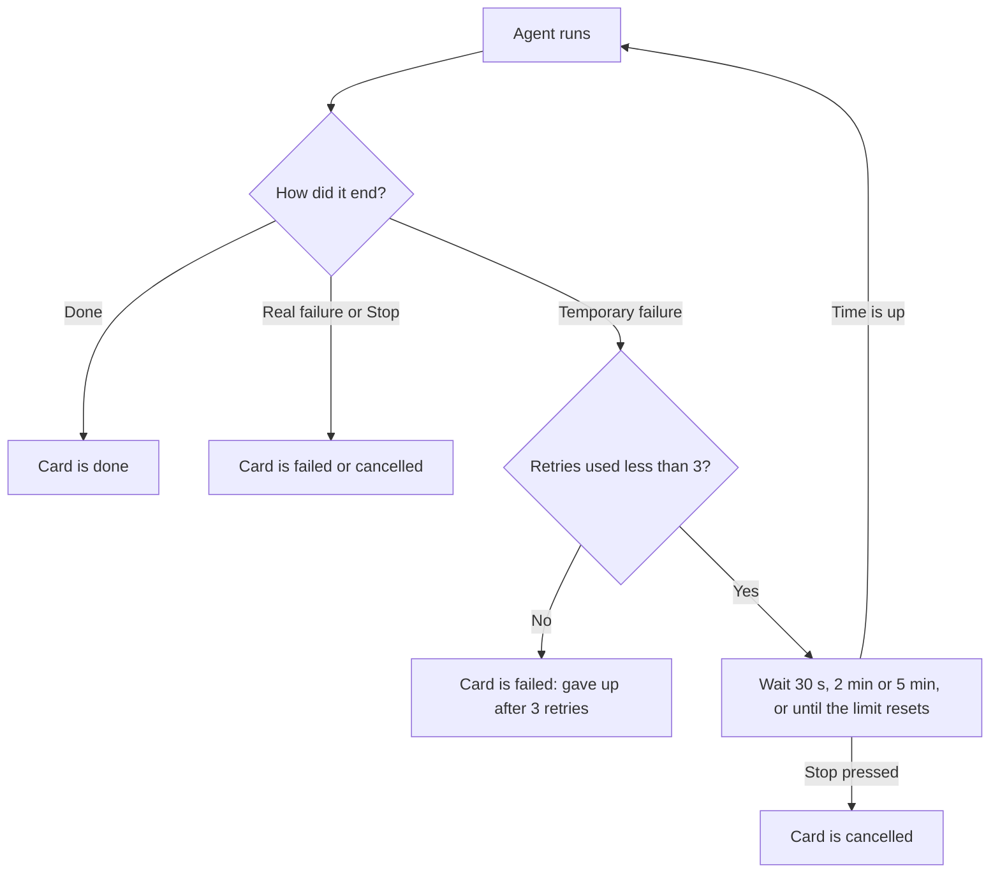
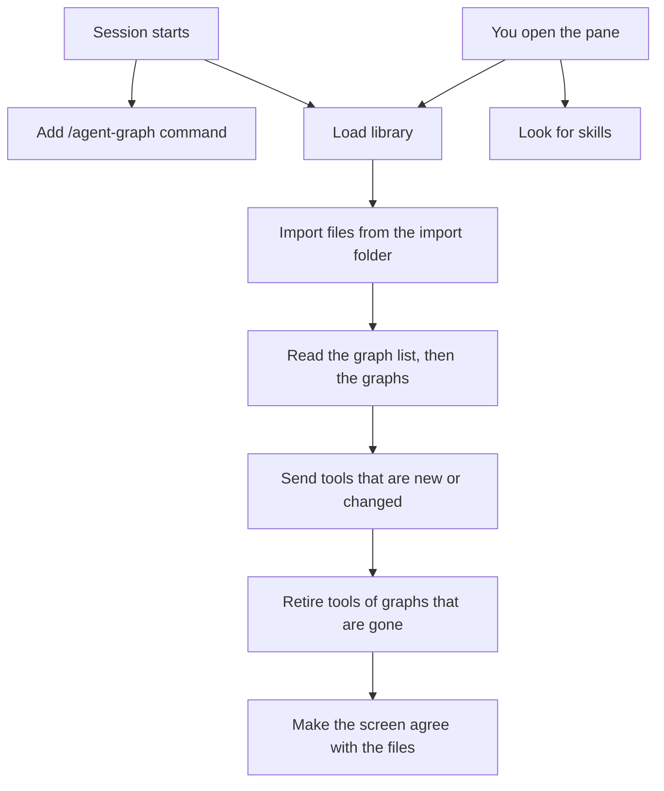

# How the agent-graph mod works

This file explains the mod in plain language. Each section covers one part of the system.

## When an agent fails for a temporary reason

A run starts each card's agent and waits for it to finish. Sometimes an agent stops for a reason that goes away by itself. The run now handles these cases without you typing "continue".

**What counts as temporary**

- You hit a usage or session limit.
- The service is rate limited (429) or overloaded (529).
- The network drops (for example ENOTFOUND, ECONNRESET, or "connection lost").
- The service has a server error (5xx).

**What never counts as temporary**

- The agent refuses.
- The agent hits its budget, or the run hits its cap.
- A check fails.
- A reviewer gives a fail verdict.
- You press Stop.
- The error is one that waiting cannot fix, such as a bad login, a billing problem, or a prompt that is too long.

**What happens**

1. The agent fails. The part that talks to the agent (Local, Headless or Cloud) decides if the reason is temporary. The run itself never reads the error words, so a check that happens to print "ECONNRESET" is never retried by mistake.
2. The run asks the failed attempt to stop, then waits: 30 seconds, then 2 minutes, then 5 minutes.
3. If a usage limit says when it resets, the run waits until 30 seconds after that time instead. It never waits more than 6 hours.
4. The agent then starts again from the beginning, with the same input. It is a fresh start, not a continuation of the failed conversation.
5. Each agent gets at most 3 retries in a run. If a fourth failure comes, the agent ends as failed. Its error ends with "(gave up after 3 automatic retries)".
6. Pressing Stop while it waits ends the wait. The agent ends as cancelled.



**What you see**

- The card keeps its running colour. It shows `◷` in place of the spinner, and a line such as `retry 1/3 · in 1:30` that counts down. This is shorter than "waiting · retry 1/3 · 1:30" on purpose, because that does not fit in the card's 22 cells.
- The inspector shows "Waiting to retry (1 of 3)", why the agent failed, and when it will try again. For a usage limit with a reset time, it says when the limit resets. It also reminds you that Stop ends the wait.
- After a retry, the inspector lists what was retried: `Retried automatically: 14:02 rate limited (429) · 14:05 network error`.
- The saved run record lists every retry with its number, time, cause, wait and (on Cloud) the link to the failed session. Older records without this list still open.

**Good to know**

- A retry pays for the work again. Each attempt has its own budget, so one agent can spend up to four times its budget in a run. The run cap still stops the whole run, because the cost of every attempt adds up.
- The card's elapsed time counts all attempts together.
- A waiting agent still holds one of the four running places for the whole wait. A long usage-limit wait can therefore hold a place for hours.
- On Cloud, "lost contact with the session" is retried only if the stop request was confirmed. Otherwise the old session may still be running and charging, and a new one would run beside it.
- The mod never archives or deletes a failed Cloud session when it retries.
- If you restart Claude Code during a wait, the run does not resume.

## Headless graphs

A graph can run on **Local**, **Headless** or **Cloud**. The toolbar button cycles through them. Headless runs every card as its own separate `claude -p` process, started by the mod.

**Why it works in auto mode**

- Each card is a fresh Claude Code session in auto mode. Auto mode judges each action against what that session was asked to do, and what it was asked is the card's own prompt.
- Local cards run inside your session instead. There, auto mode judges them against your whole conversation, not against the card's job.
- A Headless card therefore gets approvals that fit its own task, and you are not asked about every action.

**What to know**

- Each card is its own process, so its cost is exact once the card ends. Local shows estimates (`≈`); a Headless card shows the real total that Claude Code reports. While the card runs, you see a running estimate.
- A card's delegates (helpers) run inside the card's process. Their calls show nested under the card's Agent call.
- A card can only start its own delegates if its tool list is set. If a card uses all tools and has delegates, nothing stops it from starting other agents too (Local blocks this). A card with no delegates cannot start any agent.
- A card with no model set uses Claude Code's default model, not the model you picked with /model in your session.
- The card's budget stops it. If it reaches its budget, the card fails with "Hit its $X budget."
- Check cards run as on Local.
- Stop asks the card's process to end. It may finish the step it is on first. Automatic retries after temporary failures work the same as on Local and Cloud.

## Claude can read and edit graphs

Claude has two tools for your agent graphs, `read_graph` and `edit_graph`. A graph is named by its id or its exact name; it need not be open. When the edited graph is the open one, the pane redraws.

**The two tools**

- Only your main conversation can use them. A delegate (helper) is refused.
- Both refuse an untrusted graph. Review it in the pane first.
- `read_graph` shows the graph as text. It does not read an instructions file from outside the graph's own folder.
- `edit_graph` takes one batch of changes: add, change or remove cards and arrows, set a card's instructions, and set the graph's name, description, backend and run cap.
- A batch is one undo step in the pane.
- A value that is not allowed is refused, not clamped. If one change in a batch is refused, the whole batch is refused.
- Edits are refused while the graph runs.

**Who approves an edit**

- A deny rule for `mcp__agent-graph__edit_graph` refuses the edit.
- With an allow rule, the batch applies with no dialog. The exception: a batch that adds a check card, or changes a check card's command, always asks.
- With no rule, it asks. The dialog shows every change in full. Apply applies it. Cancel, closing the dialog, or a `-p` run without the allow rule changes nothing.

**What applies with no dialog under the allow rule**

- Instructions, tools (an empty list means all tools) and models.
- Context files. On Cloud, those files are uploaded.
- Budgets up to $100 for a card and a run cap up to $500.
- The backend, arrows and names.
- Turning cards on and off. This includes turning a disabled check card back on, joining an arrow to a check, or switching a graph back to Local. Each puts an existing check command back to work.

Only a new check card or a changed check command always asks.

**Permission modes**

- With `bypassPermissions`, every change except check-card changes applies silently.
- In auto mode, the mod shows its own dialog. It may do the same with `dontAsk`.

**To allow edits**

Add the tool to `permissions` in `~/.claude/settings.json`:

```json
{ "permissions": { "allow": ["mcp__agent-graph__edit_graph"] } }
```

You can also add it with `/permissions`.

## Shared graphs

You can drop a graph file into `~/.claude/agent-graph/import/`. The mod imports it when a session starts or when you open `/agent-graph`. Treat a graph from someone else like a script from someone else.

**What an imported graph can do**

- Its check cards run commands on your computer.
- Its agent cards read the files they name into their prompts. On Cloud, those files are uploaded.
- It spends money, up to its limits: at most $100 for each card, at most $500 for the whole run, and at most 10 retries on an arrow. A value that is missing or too high is set back to a safe one. A missing run cap becomes $20.

**It starts untrusted**

- An imported graph has no tool for Claude, and a tool call for it is refused. Step, From here and tests are refused too.
- ▶ Run opens an approval view instead of starting. It shows:
  - the backend, the graph's description (Claude would read it as the tool's text) and the run cap;
  - each check card's command;
  - each agent card's tools, model, budget, context files, helpers and "when to use" text.
- Text from the graph's author is shown in quotes, in full. A line break shows as `\n`.
- **Trust and run** trusts the graph and runs it. **Cancel** keeps it untrusted.
- Graphs that were in your library before this check count as trusted. Delete and import again any that came from outside.

**What an import loses**

- A card's instructions file path is set to `<home>/.claude/agent-graph/<graph id>/<card id>.md`. The old path is never read.
- A shared graph therefore arrives with empty instructions, unless the sharer also sends those `.md` files and you put them at that path.
- Once Claude has edited a card's instructions, the card no longer sits at `<graph id>/<card id>.md`. The new text is saved as a new file in the same folder, and older versions stay until the graph is deleted. So do not ship the `<graph id>/<card id>.md` files of an edited graph: they hold the old text, or none. Send the current text of each edited card, and tell the receiver to save it at `<graph id>/<card id>.md` (an import reads only that path). The graph file says which file a card uses now.
- Cloud agent links in the file are dropped. The cards link to new Cloud agents the first time you run on Cloud.

**Safety limits**

- The mod writes and deletes only inside the graph's own folder. It refuses any other path and shows a message.
- On Windows, the mod passes only paths made of ASCII letters, digits, space and `_ - . : / \` to `cmd`. If your home folder has other letters (for example `C:\Users\Müller`), the mod cannot delete instructions files, remove import files or open files in your editor. Each refusal shows a message.
- When Claude runs a graph, the result comes back inside a frame that says it is data from the graph, not an instruction from you. The graph's output cannot close the frame.
- Headless auto mode is not a safety boundary against a malicious graph. It judges each action against the card's prompt, and the graph's author wrote that prompt.
- A Headless card's process inherits this session's environment, apart from six Claude Code variables that are blanked. The engine can only add variables, not remove them, so keys in your environment reach the card.

## What happens when Claude Code starts and when you open the pane

Your graphs are saved as files. The mod has to read them, and it has to tell Claude which tools exist (one per graph, plus `read_graph` and `edit_graph`). It does this in a short "load". The load reads each saved file once, and it reads the graphs side by side, not one after another.

**When a session starts**

1. The mod adds the `/agent-graph` command.
2. At the same time, it loads your library:
   - it imports any graph files in `~/.claude/agent-graph/import/` (they start untrusted, see "Shared graphs");
   - it reads the list of your graphs once, then reads the graphs themselves side by side;
   - it gives Claude one tool for each graph that can run, and the two editor tools;
   - it asks Claude Code which graph tools are already there, and retires any that no longer match a graph (a graph deleted or broken from another session). Claude Code cannot remove a tool, so a retired tool stays in the list with a note saying "do not call this".
3. It makes the screen agree with the files. If Claude Code was reloaded while the pane showed a run in progress, the pane now shows that run as stopped, because nothing is running it any more. If the open graph changed on disk, the pane shows the saved copy.
4. If any tool could not be added, you see one message.

The session start does not look for skills. That happens only when the pane opens.

**When you open the pane (`/agent-graph`)**

1. The load above runs again, so the pane always shows what is saved, also after another session changed it. With no graph open, the first graph opens.
2. At the same time, the mod looks for your skills (see below).
3. Before a graph is shown, the mod reads everything the pane needs for it (the cards' instruction files, the list of saved runs, the tests). The pane then draws once, with the graph and an empty selection, not with the new graph and the old selection.

**How the tools are kept in step with the graphs**

- Each edit saves the graph. If the tool for that graph would be exactly the same as the one Claude Code already has, the mod does not send it again. Moving a card with the arrow keys therefore sends nothing. Each send makes Claude Code reconnect the mod's tools, so this saves a lot of reconnects.
- A tool is sent again when anything in it changes, for example the graph's name or description.
- When Claude Code starts, or the plugins are reloaded, the mod remembers nothing, so it sends every tool once. There is no way to send them in one go.
- If one tool cannot be added, the others are still added, and you get one message.
- Loads never overlap. If you edit a graph while a load is running, the edit waits its turn.

**Linked skills**

- A card can name skills. The pane lists them in the card's "+ skill" picker, and Cloud uploads them.
- Skills are folders with a `SKILL.md` file, in `~/.claude/skills` and in the project's `.claude/skills`. Many people keep their skills elsewhere and link them into these folders. The mod now follows such a link.
- A link counts only if the folder it leads to is inside your home folder and has a `SKILL.md`. A link that leads outside your home folder is ignored.
- Before, a card that named a linked skill said "Skill … was not found". Now it is found.
- The picker takes at most 64 skills. If you have more, the card shows more than one picker: "+ skill", then "+ skill (name…)" where the name is the first skill of that picker. Every skill is in one of them.


