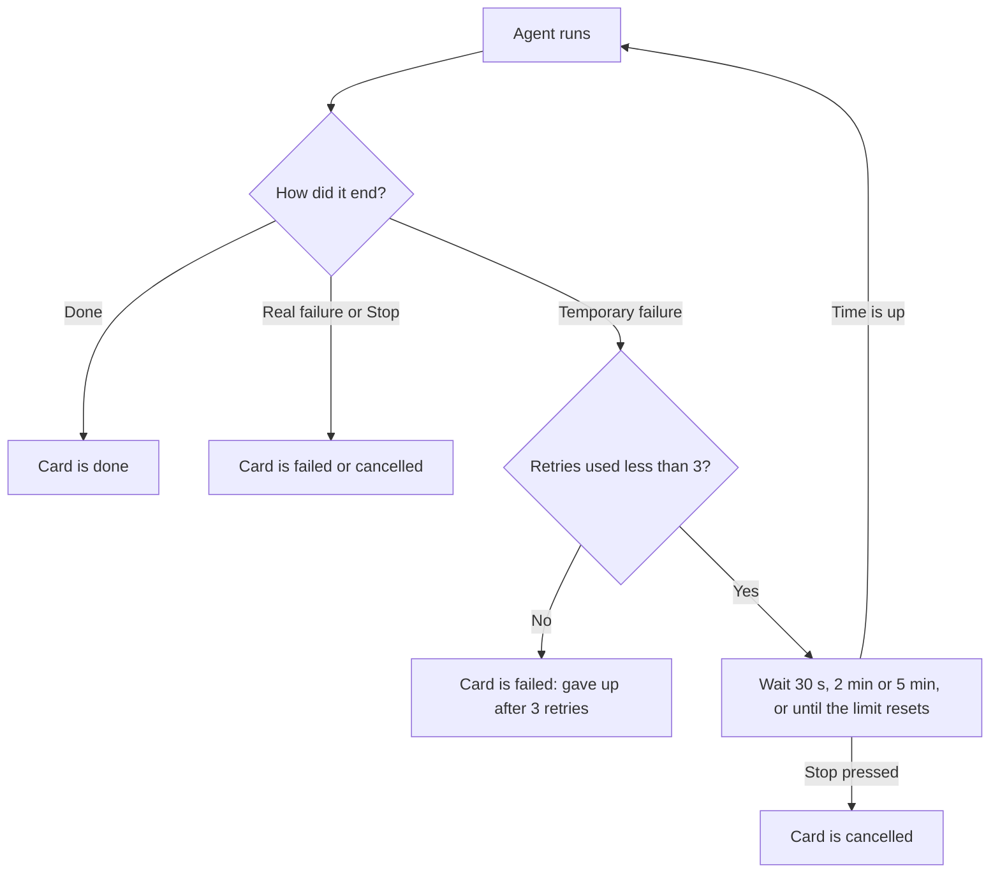

# How the agent-graph mod works

This file explains the mod in plain language. Each section covers one part of the system.

## When an agent fails for a temporary reason

A run starts each card's agent and waits for it to finish. Sometimes an agent stops for a reason that goes away by itself. The run now handles these cases without you typing "continue".

**What counts as temporary**

- You hit a usage or session limit.
- The service is rate limited (429) or overloaded (529).
- The network drops (for example ENOTFOUND, ECONNRESET, or "connection lost").
- The service has a server error (5xx).

**What never counts as temporary**

- The agent refuses.
- The agent hits its budget, or the run hits its cap.
- A check fails.
- A reviewer gives a fail verdict.
- You press Stop.
- The error is one that waiting cannot fix, such as a bad login, a billing problem, or a prompt that is too long.

**What happens**

1. The agent fails. The part that talks to the agent (Local, Headless or Cloud) decides if the reason is temporary. The run itself never reads the error words, so a check that happens to print "ECONNRESET" is never retried by mistake.
2. The run asks the failed attempt to stop, then waits: 30 seconds, then 2 minutes, then 5 minutes.
3. If a usage limit says when it resets, the run waits until 30 seconds after that time instead. It never waits more than 6 hours.
4. The agent then starts again from the beginning, with the same input. It is a fresh start, not a continuation of the failed conversation.
5. Each agent gets at most 3 retries in a run. If a fourth failure comes, the agent ends as failed. Its error ends with "(gave up after 3 automatic retries)".
6. Pressing Stop while it waits ends the wait. The agent ends as cancelled.

**What you see**

- The card keeps its running colour. It shows `◷` in place of the spinner, and a line such as `retry 1/3 · in 1:30` that counts down. This is shorter than "waiting · retry 1/3 · 1:30" on purpose, because that does not fit in the card's 22 cells.
- The inspector shows "Waiting to retry (1 of 3)", why the agent failed, and when it will try again. For a usage limit with a reset time, it says when the limit resets. It also reminds you that Stop ends the wait.
- After a retry, the inspector lists what was retried: `Retried automatically: 14:02 rate limited (429) · 14:05 network error`.
- The saved run record lists every retry with its number, time, cause, wait and (on Cloud) the link to the failed session. Older records without this list still open.

**Good to know**

- A retry pays for the work again. Each attempt has its own budget, so one agent can spend up to four times its budget in a run. The run cap still stops the whole run, because the cost of every attempt adds up.
- The card's elapsed time counts all attempts together.
- A waiting agent still holds one of the four running places for the whole wait. A long usage-limit wait can therefore hold a place for hours.
- On Cloud, "lost contact with the session" is retried only if the stop request was confirmed. Otherwise the old session may still be running and charging, and a new one would run beside it.
- The mod never archives or deletes a failed Cloud session when it retries.
- If you restart Claude Code during a wait, the run does not resume.

## Headless graphs

A graph can run on **Local**, **Headless** or **Cloud**. The toolbar button cycles through them. Headless runs every card as its own separate `claude -p` process, started by the mod.

**Why it works in auto mode**

- Each card is a fresh Claude Code session in auto mode. Auto mode judges each action against what that session was asked to do, and what it was asked is the card's own prompt.
- Local cards run inside your session instead. There, auto mode judges them against your whole conversation, not against the card's job.
- A Headless card therefore gets approvals that fit its own task, and you are not asked about every action.

**What to know**

- Each card is its own process, so its cost is exact once the card ends. Local shows estimates (`≈`); a Headless card shows the real total that Claude Code reports. While the card runs, you see a running estimate.
- A card's delegates (helpers) run inside the card's process. Their calls show nested under the card's Agent call.
- A card can only start its own delegates if its tool list is set. If a card uses all tools and has delegates, nothing stops it from starting other agents too (Local blocks this). A card with no delegates cannot start any agent.
- A card with no model set uses Claude Code's default model, not the model you picked with /model in your session.
- The card's budget stops it. If it reaches its budget, the card fails with "Hit its $X budget."
- Check cards run as on Local.
- Stop asks the card's process to end. It may finish the step it is on first. Automatic retries after temporary failures work the same as on Local and Cloud.
